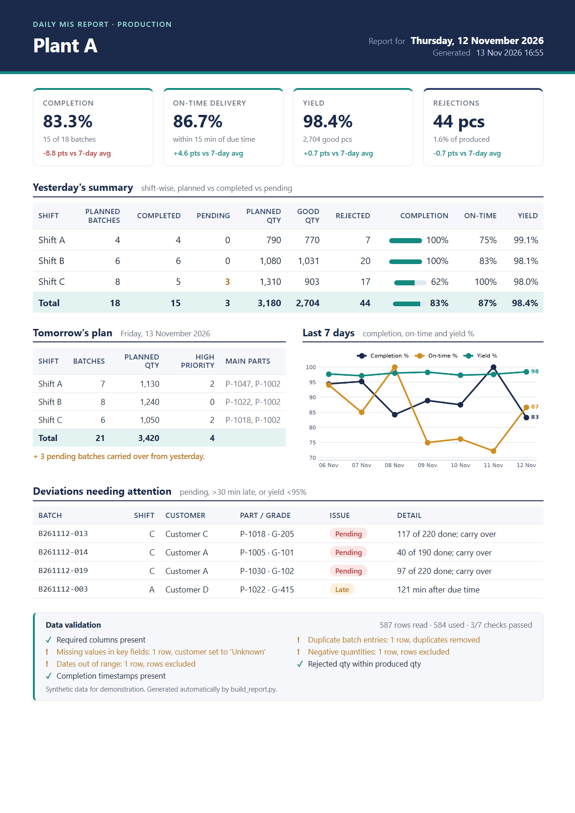

# Daily MIS Report Automation

**Turns a day's raw production data into a checked, print-ready one-page management report in under a minute.**



[View the sample PDF report](output/sample_daily_mis_report.pdf)

---

## Problem → What I built → Result

**The problem**
Every morning, plant managers need to know: what did we plan yesterday, what actually got done, what is still pending, and what needs attention today. Putting this together by hand from shift logs and spreadsheets typically takes **2–3 hours a day**. The format changes depending on who prepares it, and copy-paste mistakes (duplicate rows, typos, wrong dates) slip into the numbers.

**What I built**
A Python script that reads the production data and produces the full daily report automatically:

- **KPI cards**: completion %, on-time %, yield % and rejections, each compared with the previous 7-day average
- **Yesterday's summary**: planned vs completed vs pending, broken down by Shift A / B / C
- **Tomorrow's plan**: batches and quantities by shift, high-priority jobs and work carried over
- **Deviations needing attention**: pending, late or low-yield batches, so problems are seen first
- **7-day trend chart**: shows whether performance is getting better or worse
- **Data validation before the report is built**: checks for missing values, duplicates, negative quantities, dates outside the reporting window and inconsistent records. Bad rows are fixed or excluded, and the results are printed and shown in the report footer so readers know the numbers have been checked.

**The result**
- Report preparation goes from **2–3 hours of manual work to under a minute**
- **Same format every day**, ready to print or email as PDF
- **Built-in data checks**, so errors are caught before they reach management
- Easy to adapt to new KPIs, plants or thresholds

> Based on reporting automation I built for manufacturing clients in my current role. This version uses synthetic data so it can be shared publicly. All plant, customer, grade and part names are fictional.

## Skills shown

| Area | What is used |
|---|---|
| Python | End-to-end automation script, command-line options |
| pandas | Cleaning, aggregation, shift-wise and daily KPIs, 7-day comparisons |
| Data validation | Missing values, duplicates, negative quantities, date-range and logic checks |
| Jinja2 + HTML/CSS | Report template with a consistent, print-ready A4 layout |
| matplotlib | Trend chart embedded in the report |
| Report automation | Headless Chrome export to PDF and PNG, no manual steps |

## What's in the repository

```
daily-mis-report-automation/
├── generate_sample_data.py     # creates 30 days of synthetic production data (fixed seed)
├── build_report.py             # validation, KPIs, chart, HTML render, PDF/PNG export
├── templates/
│   ├── report.html             # Jinja2 report template
│   └── report.css              # print stylesheet (A4)
├── sample_data/
│   ├── production_log.csv      # batch-level actuals, 3 shifts per day
│   └── production_plan.csv     # next day's plan
├── output/
│   └── sample_daily_mis_report.pdf
└── docs/
    └── report_preview.png
```

The sample data deliberately includes a few common data-entry problems (a duplicate batch, a missing customer, a negative quantity and a date outside the window) so the validation step can be seen working:

```
Data validation summary
----------------------------------------------------------------
  [PASS] Required columns present               0 row(s)
  [FLAG] Duplicate batch entries                1 row(s)  duplicates removed
  [FLAG] Missing values in key fields           1 row(s)  customer set to 'Unknown'
  [FLAG] Negative quantities                    1 row(s)  rows excluded
  [FLAG] Dates out of range                     1 row(s)  rows excluded
  [PASS] Rejected qty within produced qty       0 row(s)
  [PASS] Completion timestamps present          0 row(s)
----------------------------------------------------------------
  587 rows read, 584 rows used, 4 of 7 checks raised issues
```

## How to run

Requires Python 3.10+ and Google Chrome (used to export the PDF).

```bash
pip install -r requirements.txt
python generate_sample_data.py
python build_report.py
```

The report is written to `output/` as HTML and PDF. Optional flags:

```bash
python build_report.py --date 2026-11-10                     # report for a specific day
python build_report.py --name sample_daily_mis_report --png docs/report_preview.png
```

Thresholds (on-time grace period, late flag, yield target) are set at the top of `build_report.py`.
